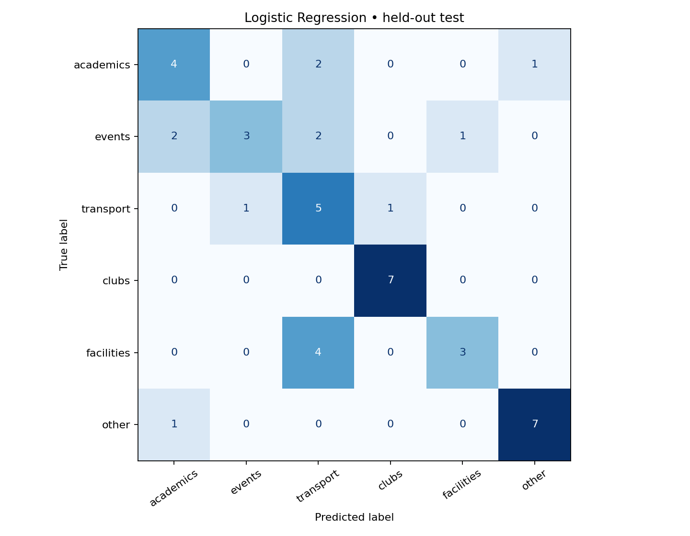

# 🧭 Campus Compass
### A reproducible campus-query intent classifier

Route student questions to **Academics · Events · Transport · Clubs · Facilities · Other** using TF-IDF and two classical ML models. Includes trained models, a CLI, an optional Streamlit dashboard, data audit, actual prediction errors and reproducible evaluation.

> This project classifies questions; it does not answer them. Its 216 examples are original AI-assisted English queries. CLINC150 is a task reference, **not** the training dataset. The supplied task explicitly permits writing original queries. Review and understand the code before submission and follow the club's AI-assistance disclosure policy.

## Quick start
Use **Python 3.11 or 3.12**. Extract the ZIP, then open a terminal inside `campus-query-classifier`.

```bash
python -m venv .venv
```
Activate it:
- Windows PowerShell: `.venv\Scripts\Activate.ps1`
- Windows Command Prompt: `.venv\Scripts\activate.bat`
- macOS/Linux: `source .venv/bin/activate`

```bash
python -m pip install -r requirements.txt
python predict.py "When does the campus shuttle leave?"
```
The trained models are included. To reproduce training and regenerate every result:

```bash
python train.py
python -m unittest discover -s tests -v
```
If a serialized model raises a version mismatch, retrain in your environment. Load only trusted joblib files.

### Optional interactive dashboard
```bash
python -m pip install -r requirements-ui.txt
python -m streamlit run app.py
```
Open the local address printed in the terminal (normally http://localhost:8501). The demo includes example queries, model scores, fallback explanations, two-model metrics, confusion matrices, mistakes and CSV export. A laptop/desktop Python environment is needed; a ZIP file does not run directly in an Android browser. No API key, GPU or remote inference service is required. Dependency installation needs internet; inference does not.

### Interactive CLI
```bash
python predict.py
```
Type a query, then `quit` to exit. A single-query invocation returns JSON containing the routed category, original top category, score, fallback reason, threshold and all six scores. Empty, punctuation-only/numeric-only and overlong queries are rejected.

## Actual measured results
Fixed random seed **42**. Stratified **129 train / 43 validation / 44 test** examples.

| Model | Validation macro-F1 | Test accuracy | Test macro precision | Test macro recall | Test macro-F1 |
|---|---:|---:|---:|---:|---:|
| Logistic Regression | 0.471 | 65.9% | 0.701 | 0.661 | 0.654 |
| Multinomial Naive Bayes | 0.427 | 56.8% | 0.611 | 0.571 | 0.572 |

Logistic Regression is selected **using validation macro-F1**, not test accuracy. Validation also chooses the rejection threshold (0.20 for Logistic Regression; 0.00 for Naive Bayes). Test metrics above include fallback routing. Raw accuracy is retained separately in `reports/metrics.json`.

These results describe one small synthetic split. They are not evidence of real campus performance. Scores are intentionally not inflated through test-set tuning. Read [the complete evaluation](reports/evaluation.md) for real correct/incorrect examples, per-confusion counts and limitations.



## Design
1. **Data:** 36 original queries per category; [data card](data/DATA_CARD.md) documents category boundaries and provenance.
2. **Cleaning:** Unicode normalization, lowercasing, punctuation/whitespace cleanup, missing/empty checks and normalized duplicate removal. No aggressive stopword removal or stemming.
3. **Split:** stratify labels with a fixed seed; keep validation and test separate.
4. **Features:** word unigram/bigram TF-IDF, fitted on the training set only. Bigram features retain short context such as “bus pass”.
5. **Models:** Logistic Regression (discriminative linear model) versus Multinomial Naive Bayes (probabilistic baseline). Fixed model hyperparameters; validation searches only model choice and rejection threshold.
6. **Serving:** shared `core.py` ensures the same cleaning and routing rules at evaluation and inference. Entirely unseen vocabulary or low top-model scores route to Other. A learned Other class also catches some familiar unrelated questions.

Model choice stays frozen before test evaluation. The deployed model remains trained on the training partition, so its reports match its predictions. Nothing silently refits on the test set.

## Category boundaries
| Student intent | Category |
|---|---|
| Course registration, exams, grades, fees | academics |
| Attend a workshop, fest or competition | events |
| Shuttle, bus passes, parking, routes | transport |
| Join a society, recruitment, membership | clubs |
| WiFi, library, room booking, repairs | facilities |
| Unrelated general question or fallback | other |

For example, “join the coding club” is Clubs, “attend its hackathon” is Events and “book the venue” is Facilities. Multi-intent questions may be ambiguous; split them into separate questions.

## Submission checklist
- [x] Explain six-category construction and provide at least 10 examples per category
- [x] Inspect/clean data; fixed random seed
- [x] Held-out accuracy, precision, recall and F1 (per-class, macro and weighted)
- [x] Prediction CLI
- [x] Correct and incorrect prediction examples
- [x] Compare two models
- [x] Confusion matrices and error analysis
- [x] Confidence scores and Other/fallback handling
- [x] Optional small web UI
- [x] Source, dataset, trained models, evaluation report and setup instructions

## Repository map
```text
app.py                  Optional Streamlit dashboard
core.py                 Shared cleaning, validation and inference
predict.py              JSON and interactive CLI
train.py                Data audit, split, train, compare and evaluate
requirements.txt        Core dependencies
requirements-ui.txt     Dashboard dependencies
data/queries.json       Editable original examples
data/campus_queries.csv Cleaned data with provenance and split
data/DATA_CARD.md       Labels, rationale and limitations
models/                 Both models plus selected best.joblib
reports/                Metrics, threshold search, predictions, plots and evaluation
tests/test_project.py   Data leakage, validation and serving consistency checks
docs/INTERVIEW_GUIDE.md Explain the project and defend design choices
```

## Limitations and next steps
- Small AI-assisted corpus, not independently collected student queries; no campus-specific fact database.
- English only; Hindi/Hinglish, slang, misspellings and mixed intents have no measured support.
- Exact duplicates are blocked; semantically related examples may span splits.
- Probability scores are uncalibrated. The top score is **not** a guarantee of correctness or the probability of the routed fallback label.
- Thresholding is a heuristic, not robust out-of-distribution detection. Unknown queries can still receive a confident wrong class.
- Improve with independently authored student queries and paraphrase-group splits; compare character n-grams or sentence embeddings in a new experiment with a fresh untouched test set. Do not repeatedly optimise on the published test errors.

## Upload to GitHub
Create an empty repository, then run inside this folder (replace the URL with your actual repository):
```bash
git init
git add .
git commit -m "Add Campus Compass classifier with reproducible evaluation"
git branch -M main
git remote add origin https://github.com/YOUR_USERNAME/YOUR_REPOSITORY.git
git push -u origin main
```
If the destination repository already has files/history, clone it first and add this project there; do not force-push. Never commit your `.venv` directory. A GitHub repository URL is needed before an assistant can upload to the intended destination.

## Reference
Task resource: https://huggingface.co/datasets/DeepPavlov/clinc150 . It is a general intent dataset; this submission uses the task's permitted original-query alternative. No CLINC150 samples or labels were mapped into the included data.
